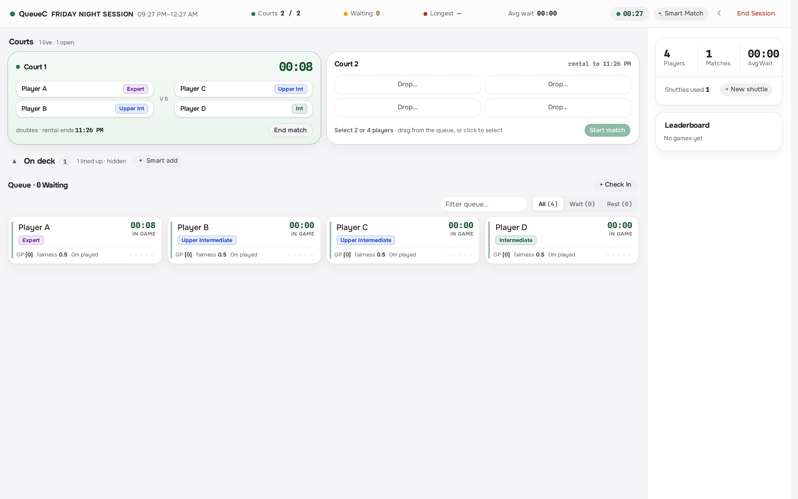

# QueueC

[](https://github.com/jovenpaoloangeles/QueueC/actions/workflows/ci.yml)
[](LICENSE)

A self-hosted queue manager for badminton. Players check in, the queue tracks
who has actually been waiting (time spent playing doesn't count), and lineups
go out to the courts. Court rental time, shuttles, and the session leaderboard
are tracked along the way.



Every browser viewing the session stays in sync in real time, so a shared
screen is all players need to see when they're up.

## Quickstart (Docker)

```bash
curl -fsSL https://raw.githubusercontent.com/jovenpaoloangeles/QueueC/master/install.sh | bash
```

Open `http://localhost:3001`. The script clones the repo, builds the image,
seeds `players.json` from the example roster, and starts the container. All
persistent data (SQLite db + roster) lands in `./queuec/data`; re-running the
script updates and restarts. `PORT`, `QUEUEC_DIR`, and `QUEUEC_CONTAINER` env
vars override the defaults — see the header of
[install.sh](install.sh).

Prefer the raw commands:

```bash
git clone https://github.com/jovenpaoloangeles/QueueC.git
cd QueueC && docker build -t queuec .
docker run -d --name queuec -p 3001:3001 -v "$PWD/data:/data" queuec
```

Without Docker: install [Bun](https://bun.sh), then
`bun install && bun install --cwd server && bun install --cwd client` and
`bun run dev` (client on Vite's port, API on 3001).

## What it does

- **One-screen setup** — session name, start time, courts with per-court
  rental hours and staggered opens, alphabetical player pool, one Start button.
- **Live courts** — drag-and-drop 2×2 lineup drafting, confirm-gated match
  starts, per-court rental countdown with mid-match extend, team rearranging.
- **On Deck slate** — build lineups manually or review a Smart Match plan;
  slates auto-promote to the next free court; nothing starts unconfirmed.
- **Smart Match** — a dry-run-first matching heuristic (wait time, games
  played, skill variance, team balance, pair redundancy); it never writes
  without showing you the plan. [Algorithm deep-dive →](docs/algorithm.md)
- **Fair queue** — net-wait clocks (playing time doesn't count toward your
  wait), rest/wake, alphabetical check-in, remove-with-confirm.
- **Shuttles & stats** — 1 shuttle per game by default with manual extras,
  live leaderboard (W/L, win %, point differential).
- **Session controls & history** — end/new session with confirm; everything
  persists in SQLite.

## Documentation

| Doc                                          | For                                                              |
| -------------------------------------------- | ---------------------------------------------------------------- |
| [docs/usage.md](docs/usage.md)               | Operating a session (queue-master guide)                         |
| [docs/architecture.md](docs/architecture.md) | How the server, SSE state model and client fit together          |
| [docs/algorithm.md](docs/algorithm.md)       | Smart Match: the shipped heuristic + the target optimizer design |
| [docs/testing.md](docs/testing.md)           | Running the test suites                                          |
| [docs/ai-harness.md](docs/ai-harness.md)     | Contributing with Claude Code / an AI agent                      |
| [docs/workflow.md](docs/workflow.md)         | The original product workflow spec                               |
| [ROADMAP.md](ROADMAP.md)                     | Planned features by version — check off as shipped               |
| [CLAUDE.md](CLAUDE.md)                       | Agent policy this repo is developed under                        |

## Development

```bash
bun run install:all        # root + server + client
bun run dev                # client + API with reload

cd tests && bun run test:server   # sub-second API regressions
cd tests && bun run test          # unit + full Playwright e2e
```

CI runs lint (Biome), the server tests, the client build, and the full e2e
suite on every push/PR — the suites boot their own throwaway servers, so
nothing touches a real instance. See [CONTRIBUTING.md](CONTRIBUTING.md),
[docs/testing.md](docs/testing.md) and [docs/ai-harness.md](docs/ai-harness.md)
before your first change.

## License

[MIT](LICENSE)
