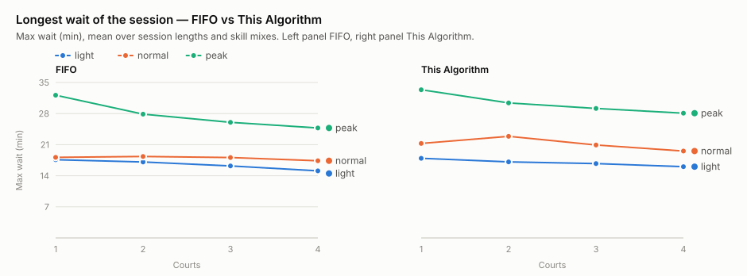
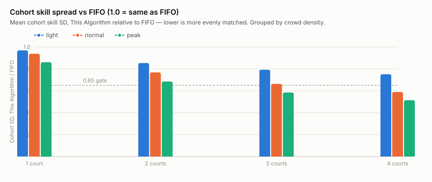
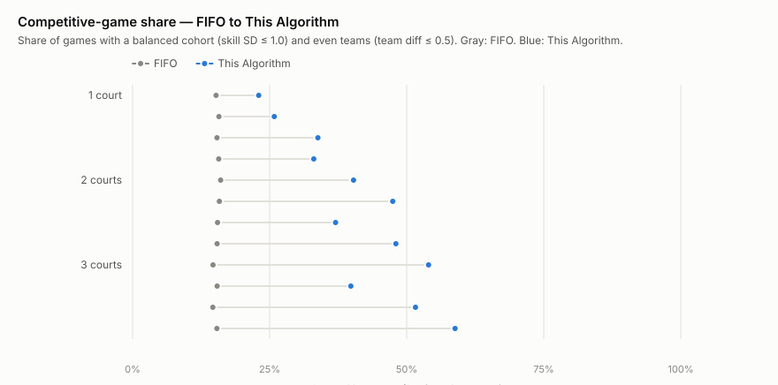
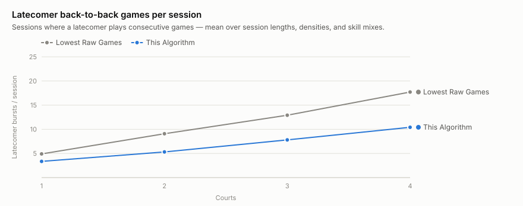

# Simulation Sweep Report — "This Algorithm" (ε-lexicographic doubles matcher)

Generated 2026-10-17 by `tests/sim/sweep-sim.mjs` (deterministic, seeded CRN — rerunning the script reproduces every number except wall-clock timings, which are excluded). "This Algorithm" is the production two-stage ε-lexicographic engine (`EPSILON_LEX` in code: `server/logic/smartQueue.js planBatch`, spec: `docs/algorithm.md`). Baselines: **FIFO** (top-4 by wait) and **Lowest Raw Games** (top-4 by fewest games played — the naive fairness policy).

## Modeled club session (realistic dynamics)

The discrete-event simulation drives the production engine end to end, including its timestamped consecutive-rest rule (`started_at`/`ended_at` in match history) and joint multi-court batching. Each session models:

- **Court-scaled crowd density** — every court always hosts exactly 4 players per game (doubles). Crowd density is the roster size per court's rotation: total roster = courts × players-per-court (light 5.5, normal ≈7.3, peak 9.0 — i.e., 1.5 / 3.3 / 5.0 people resting per court while 4 play).
- **Staggered arrivals** — an on-time wave plus ~27% late check-ins spread over 15–75 min; latecomers inherit the median virtual game count.
- **Voluntary rest breaks** — after any game, a ~6% chance of sitting out 8–15 min.
- **Early departures** — ~12% of on-time players leave during the final 30 min.
- **Match-dependent game length** — base 13.8 ± 2.1 min, longer on higher-skilled balanced courts, shorter on lopsided blowouts, plus 0.5–1.3 min court turnaround lag.
- **Multi-court batching** — when several courts free up together, the engine plans them jointly (and stages on-deck equivalents via `courtCount`).

## Sweep grid

| Axis           | Values                                                                                                                                                  |
| -------------- | ------------------------------------------------------------------------------------------------------------------------------------------------------- |
| Courts         | 1, 2, 3, 4                                                                                                                                              |
| Session length | 120 min, 180 min, 240 min                                                                                                                               |
| Skill profile  | club-balanced, beginner-heavy, advanced-club, wide-mix (N(mean, sd), clipped 1.5–9.5, quantized to the production 1–7 tiers)                            |
| Crowd density  | light (5.5/court), normal (7.3/court), peak (9.0/court) — roster = courts × players-per-court; 4 play per court (doubles) at all times, the rest rotate |
| Seeds per cell | scaled to ≥ 1000 simulated games for This Algorithm (10–200)                                                                                            |

Each cell replays the **same** player skills, arrival times, breaks, departures, and game durations across all policies (Common Random Numbers), so differences are caused by the matchmaking policy alone. Gate-style checks per cell, This Algorithm vs FIFO: max wait ≤ 1.25×, cohort skill SD ≤ 0.65×, weak-link team diff ≤ 0.40, recent repeats (≤6 games) < 10%.

## Session length: 120 min

| C   | Density | Skill profile  | Games | TA p95 wait | TA max wait | FIFO max wait | ratio | TA play spread | TA SD | FIFO SD | ratio | TA team diff | TA recent rep % | TA bursts | LRG bursts | Checks |
| --- | ------- | -------------- | ----- | ----------- | ----------- | ------------- | ----- | -------------- | ----- | ------- | ----- | ------------ | --------------- | --------- | ---------- | ------ |
| 1   | light   | club-balanced  | 10    | 15.7        | 17.5        | 16.9          | 1.03  | 15             | 1.18  | 1.28    | 0.92  | 0.69         | 48.7            | 4.3       | 4.5        | 1/4    |
| 1   | normal  | club-balanced  | 10    | 16.9        | 18.3        | 17.6          | 1.04  | 23             | 1.16  | 1.30    | 0.89  | 0.68         | 32.6            | 1.9       | 3.7        | 1/4    |
| 1   | peak    | club-balanced  | 10    | 24.9        | 31.3        | 30.8          | 1.02  | 22             | 0.99  | 1.27    | 0.78  | 0.63         | 17.2            | 0.1       | 1.7        | 1/4    |
| 1   | light   | beginner-heavy | 10    | 15.6        | 17.2        | 16.8          | 1.02  | 15             | 1.05  | 1.13    | 0.93  | 0.46         | 48.9            | 4.4       | 4.5        | 1/4    |
| 1   | normal  | beginner-heavy | 10    | 16.8        | 18.2        | 17.5          | 1.04  | 23             | 1.03  | 1.15    | 0.90  | 0.45         | 33.5            | 2.0       | 3.7        | 1/4    |
| 1   | peak    | beginner-heavy | 10    | 24.8        | 31.0        | 30.6          | 1.01  | 21             | 0.92  | 1.13    | 0.81  | 0.43         | 20.1            | 0.1       | 1.8        | 1/4    |
| 1   | light   | advanced-club  | 10    | 15.8        | 17.5        | 17.1          | 1.02  | 14             | 0.70  | 0.75    | 0.93  | 0.43         | 44.0            | 4.5       | 4.4        | 1/4    |
| 1   | normal  | advanced-club  | 10    | 17.0        | 18.3        | 17.8          | 1.03  | 21             | 0.69  | 0.76    | 0.91  | 0.39         | 28.4            | 2.2       | 3.7        | 2/4    |
| 1   | peak    | advanced-club  | 10    | 25.4        | 31.5        | 31.0          | 1.02  | 20             | 0.62  | 0.75    | 0.83  | 0.36         | 12.6            | 0.1       | 1.7        | 2/4    |
| 1   | light   | wide-mix       | 10    | 15.6        | 17.5        | 16.8          | 1.04  | 14             | 1.43  | 1.55    | 0.92  | 0.77         | 47.0            | 4.3       | 4.5        | 1/4    |
| 1   | normal  | wide-mix       | 10    | 16.8        | 18.2        | 17.6          | 1.04  | 23             | 1.39  | 1.57    | 0.89  | 0.81         | 33.1            | 1.9       | 3.7        | 1/4    |
| 1   | peak    | wide-mix       | 10    | 24.9        | 31.0        | 30.6          | 1.01  | 21             | 1.16  | 1.53    | 0.76  | 0.74         | 17.4            | 0.1       | 1.7        | 1/4    |
| 2   | light   | club-balanced  | 19    | 13.2        | 16.6        | 16.5          | 1.01  | 25             | 0.97  | 1.29    | 0.75  | 0.59         | 16.4            | 7.7       | 7.3        | 1/4    |
| 2   | normal  | club-balanced  | 19    | 17.1        | 20.1        | 17.8          | 1.13  | 25             | 0.83  | 1.28    | 0.65  | 0.42         | 4.9             | 2.1       | 6.6        | 3/4    |
| 2   | peak    | club-balanced  | 19    | 23.5        | 28.7        | 26.5          | 1.08  | 24             | 0.75  | 1.29    | 0.58  | 0.38         | 2.6             | 0.1       | 4.6        | 4/4    |
| 2   | light   | beginner-heavy | 19    | 12.9        | 16.2        | 16.3          | 1.00  | 23             | 0.91  | 1.15    | 0.79  | 0.40         | 15.2            | 7.8       | 7.5        | 2/4    |
| 2   | normal  | beginner-heavy | 19    | 17.0        | 20.1        | 17.7          | 1.14  | 27             | 0.79  | 1.15    | 0.68  | 0.30         | 4.0             | 2.1       | 6.9        | 3/4    |
| 2   | peak    | beginner-heavy | 19    | 23.2        | 28.8        | 26.4          | 1.09  | 25             | 0.75  | 1.15    | 0.65  | 0.31         | 1.0             | 0.1       | 4.7        | 4/4    |
| 2   | light   | advanced-club  | 18    | 12.9        | 16.5        | 16.6          | 0.99  | 23             | 0.59  | 0.75    | 0.80  | 0.37         | 8.9             | 7.7       | 7.2        | 3/4    |
| 2   | normal  | advanced-club  | 18    | 17.2        | 20.4        | 17.9          | 1.14  | 25             | 0.53  | 0.73    | 0.72  | 0.25         | 1.8             | 1.7       | 6.6        | 3/4    |
| 2   | peak    | advanced-club  | 19    | 23.4        | 28.3        | 26.8          | 1.06  | 24             | 0.50  | 0.75    | 0.66  | 0.24         | 0.7             | 0.1       | 4.4        | 3/4    |
| 2   | light   | wide-mix       | 19    | 13.0        | 16.4        | 16.3          | 1.00  | 24             | 1.08  | 1.54    | 0.70  | 0.63         | 14.4            | 7.4       | 7.4        | 1/4    |
| 2   | normal  | wide-mix       | 19    | 17.0        | 19.9        | 17.7          | 1.12  | 25             | 0.89  | 1.53    | 0.58  | 0.49         | 4.8             | 1.9       | 6.8        | 3/4    |
| 2   | peak    | wide-mix       | 19    | 23.4        | 28.7        | 26.5          | 1.08  | 22             | 0.84  | 1.56    | 0.54  | 0.47         | 1.7             | 0.2       | 4.6        | 3/4    |
| 3   | light   | club-balanced  | 28    | 12.5        | 16.1        | 15.5          | 1.04  | 24             | 0.86  | 1.28    | 0.67  | 0.51         | 6.8             | 11.2      | 10.8       | 2/4    |
| 3   | normal  | club-balanced  | 28    | 16.4        | 19.4        | 17.5          | 1.11  | 27             | 0.70  | 1.28    | 0.55  | 0.36         | 1.0             | 3.2       | 10.2       | 4/4    |
| 3   | peak    | club-balanced  | 28    | 23.1        | 27.4        | 25.1          | 1.09  | 25             | 0.63  | 1.28    | 0.49  | 0.31         | 0.4             | 0.2       | 5.2        | 4/4    |
| 3   | light   | beginner-heavy | 28    | 12.4        | 15.8        | 15.5          | 1.02  | 24             | 0.82  | 1.14    | 0.72  | 0.38         | 5.9             | 11.4      | 11.1       | 3/4    |
| 3   | normal  | beginner-heavy | 28    | 16.3        | 19.7        | 17.4          | 1.13  | 28             | 0.68  | 1.13    | 0.60  | 0.25         | 1.4             | 3.0       | 10.3       | 4/4    |
| 3   | peak    | beginner-heavy | 28    | 23.0        | 27.2        | 25.0          | 1.09  | 26             | 0.60  | 1.14    | 0.53  | 0.20         | 0.3             | 0.2       | 5.4        | 4/4    |
| 3   | light   | advanced-club  | 27    | 12.4        | 15.9        | 15.7          | 1.01  | 25             | 0.52  | 0.73    | 0.71  | 0.30         | 2.6             | 10.9      | 10.8       | 3/4    |
| 3   | normal  | advanced-club  | 27    | 16.5        | 19.6        | 17.7          | 1.11  | 27             | 0.46  | 0.73    | 0.62  | 0.18         | 0.3             | 2.5       | 10.2       | 4/4    |
| 3   | peak    | advanced-club  | 27    | 23.3        | 27.8        | 25.4          | 1.09  | 28             | 0.42  | 0.74    | 0.57  | 0.15         | 0.1             | 0.1       | 5.1        | 4/4    |
| 3   | light   | wide-mix       | 28    | 12.5        | 15.9        | 15.5          | 1.03  | 25             | 0.98  | 1.54    | 0.64  | 0.58         | 5.9             | 11.1      | 11.1       | 3/4    |
| 3   | normal  | wide-mix       | 28    | 16.5        | 20.5        | 17.4          | 1.18  | 25             | 0.79  | 1.54    | 0.51  | 0.41         | 0.9             | 3.0       | 10.3       | 3/4    |
| 3   | peak    | wide-mix       | 28    | 23.2        | 27.6        | 25.0          | 1.10  | 25             | 0.66  | 1.57    | 0.42  | 0.34         | 0.5             | 0.2       | 5.3        | 4/4    |
| 4   | light   | club-balanced  | 37    | 11.9        | 15.3        | 15.0          | 1.02  | 27             | 0.77  | 1.27    | 0.61  | 0.45         | 2.5             | 15.3      | 13.5       | 3/4    |
| 4   | normal  | club-balanced  | 37    | 15.6        | 18.9        | 16.9          | 1.12  | 28             | 0.64  | 1.30    | 0.49  | 0.33         | 0.3             | 3.6       | 14.4       | 4/4    |
| 4   | peak    | club-balanced  | 38    | 22.4        | 26.4        | 24.1          | 1.10  | 26             | 0.58  | 1.29    | 0.45  | 0.27         | 0.0             | 0.1       | 8.3        | 4/4    |
| 4   | light   | beginner-heavy | 37    | 11.7        | 15.0        | 14.7          | 1.03  | 26             | 0.73  | 1.13    | 0.64  | 0.33         | 2.7             | 15.7      | 13.6       | 4/4    |
| 4   | normal  | beginner-heavy | 37    | 15.6        | 18.4        | 16.8          | 1.10  | 28             | 0.62  | 1.18    | 0.53  | 0.22         | 0.1             | 3.4       | 14.7       | 4/4    |
| 4   | peak    | beginner-heavy | 38    | 22.0        | 26.5        | 23.8          | 1.11  | 27             | 0.54  | 1.18    | 0.46  | 0.18         | 0.0             | 0.1       | 8.5        | 4/4    |
| 4   | light   | advanced-club  | 36    | 12.0        | 15.3        | 14.9          | 1.02  | 25             | 0.47  | 0.71    | 0.67  | 0.23         | 1.9             | 14.9      | 13.4       | 3/4    |
| 4   | normal  | advanced-club  | 37    | 15.7        | 18.6        | 17.1          | 1.09  | 28             | 0.42  | 0.72    | 0.59  | 0.17         | 0.0             | 3.0       | 14.2       | 4/4    |
| 4   | peak    | advanced-club  | 37    | 22.0        | 26.7        | 24.5          | 1.09  | 25             | 0.35  | 0.73    | 0.48  | 0.12         | 0.0             | 0.1       | 8.1        | 4/4    |
| 4   | light   | wide-mix       | 37    | 11.8        | 15.0        | 14.7          | 1.02  | 25             | 0.89  | 1.55    | 0.57  | 0.53         | 2.5             | 15.5      | 13.5       | 3/4    |
| 4   | normal  | wide-mix       | 37    | 15.5        | 18.3        | 16.7          | 1.09  | 25             | 0.69  | 1.58    | 0.44  | 0.36         | 0.1             | 3.8       | 14.6       | 4/4    |
| 4   | peak    | wide-mix       | 38    | 22.2        | 26.7        | 23.9          | 1.12  | 24             | 0.61  | 1.57    | 0.39  | 0.31         | 0.0             | 0.0       | 8.4        | 4/4    |

## Session length: 180 min

| C   | Density | Skill profile  | Games | TA p95 wait | TA max wait | FIFO max wait | ratio | TA play spread | TA SD | FIFO SD | ratio | TA team diff | TA recent rep % | TA bursts | LRG bursts | Checks |
| --- | ------- | -------------- | ----- | ----------- | ----------- | ------------- | ----- | -------------- | ----- | ------- | ----- | ------------ | --------------- | --------- | ---------- | ------ |
| 1   | light   | club-balanced  | 14    | 16.2        | 18.3        | 17.8          | 1.03  | 20             | 1.20  | 1.28    | 0.94  | 0.74         | 61.5            | 6.7       | 6.7        | 1/4    |
| 1   | normal  | club-balanced  | 14    | 17.2        | 18.9        | 18.2          | 1.04  | 26             | 1.18  | 1.29    | 0.91  | 0.71         | 40.6            | 2.9       | 5.4        | 1/4    |
| 1   | peak    | club-balanced  | 14    | 27.8        | 32.9        | 32.4          | 1.02  | 25             | 1.03  | 1.29    | 0.80  | 0.64         | 22.7            | 0.1       | 2.6        | 1/4    |
| 1   | light   | beginner-heavy | 14    | 16.0        | 18.1        | 17.7          | 1.02  | 19             | 1.08  | 1.15    | 0.94  | 0.48         | 64.1            | 6.9       | 6.8        | 1/4    |
| 1   | normal  | beginner-heavy | 14    | 17.0        | 18.5        | 18.1          | 1.02  | 25             | 1.06  | 1.14    | 0.93  | 0.46         | 43.6            | 3.0       | 5.5        | 1/4    |
| 1   | peak    | beginner-heavy | 14    | 27.4        | 32.6        | 32.1          | 1.02  | 26             | 0.96  | 1.15    | 0.84  | 0.42         | 24.2            | 0.1       | 2.6        | 1/4    |
| 1   | light   | advanced-club  | 14    | 16.2        | 18.2        | 18.0          | 1.01  | 17             | 0.70  | 0.74    | 0.94  | 0.47         | 55.1            | 6.6       | 6.6        | 1/4    |
| 1   | normal  | advanced-club  | 14    | 17.3        | 18.9        | 18.5          | 1.02  | 22             | 0.69  | 0.74    | 0.93  | 0.40         | 35.0            | 3.4       | 5.4        | 2/4    |
| 1   | peak    | advanced-club  | 14    | 28.0        | 33.0        | 32.9          | 1.00  | 25             | 0.63  | 0.75    | 0.85  | 0.35         | 19.4            | 0.1       | 2.6        | 2/4    |
| 1   | light   | wide-mix       | 14    | 16.1        | 18.1        | 17.7          | 1.02  | 19             | 1.44  | 1.53    | 0.94  | 0.81         | 59.6            | 6.8       | 6.7        | 1/4    |
| 1   | normal  | wide-mix       | 14    | 17.1        | 18.7        | 18.2          | 1.03  | 25             | 1.41  | 1.54    | 0.91  | 0.85         | 40.7            | 2.9       | 5.5        | 1/4    |
| 1   | peak    | wide-mix       | 14    | 27.6        | 32.7        | 32.1          | 1.02  | 24             | 1.21  | 1.55    | 0.78  | 0.74         | 23.2            | 0.2       | 2.6        | 1/4    |
| 2   | light   | club-balanced  | 27    | 14.0        | 17.3        | 17.2          | 1.01  | 28             | 1.02  | 1.27    | 0.80  | 0.61         | 17.1            | 12.5      | 11.3       | 1/4    |
| 2   | normal  | club-balanced  | 27    | 17.7        | 21.3        | 18.4          | 1.16  | 29             | 0.86  | 1.28    | 0.67  | 0.49         | 4.7             | 3.1       | 10.1       | 2/4    |
| 2   | peak    | club-balanced  | 28    | 25.0        | 30.1        | 28.0          | 1.08  | 28             | 0.80  | 1.29    | 0.62  | 0.44         | 2.4             | 0.3       | 6.6        | 3/4    |
| 2   | light   | beginner-heavy | 27    | 13.8        | 17.1        | 16.9          | 1.01  | 27             | 0.92  | 1.14    | 0.81  | 0.41         | 17.5            | 12.7      | 11.2       | 1/4    |
| 2   | normal  | beginner-heavy | 27    | 17.5        | 21.1        | 18.3          | 1.15  | 30             | 0.82  | 1.15    | 0.71  | 0.32         | 6.3             | 3.2       | 10.2       | 3/4    |
| 2   | peak    | beginner-heavy | 28    | 24.8        | 29.6        | 27.8          | 1.07  | 29             | 0.77  | 1.14    | 0.67  | 0.31         | 2.1             | 0.3       | 6.8        | 3/4    |
| 2   | light   | advanced-club  | 27    | 14.0        | 17.2        | 17.3          | 0.99  | 27             | 0.60  | 0.74    | 0.80  | 0.37         | 10.5            | 12.3      | 11.0       | 2/4    |
| 2   | normal  | advanced-club  | 27    | 17.8        | 21.5        | 18.6          | 1.16  | 29             | 0.53  | 0.74    | 0.71  | 0.25         | 1.8             | 3.0       | 10.0       | 3/4    |
| 2   | peak    | advanced-club  | 27    | 25.3        | 29.8        | 28.1          | 1.06  | 29             | 0.50  | 0.73    | 0.68  | 0.24         | 0.8             | 0.1       | 6.5        | 3/4    |
| 2   | light   | wide-mix       | 27    | 13.8        | 17.1        | 17.1          | 1.00  | 26             | 1.12  | 1.54    | 0.73  | 0.67         | 16.7            | 12.6      | 11.2       | 1/4    |
| 2   | normal  | wide-mix       | 27    | 17.5        | 20.8        | 18.3          | 1.14  | 27             | 0.92  | 1.55    | 0.60  | 0.53         | 5.7             | 3.0       | 10.2       | 3/4    |
| 2   | peak    | wide-mix       | 28    | 25.1        | 30.3        | 27.8          | 1.09  | 27             | 0.92  | 1.56    | 0.59  | 0.54         | 2.7             | 0.3       | 6.7        | 3/4    |
| 3   | light   | club-balanced  | 40    | 13.2        | 16.9        | 16.3          | 1.03  | 28             | 0.91  | 1.29    | 0.71  | 0.57         | 5.9             | 18.1      | 16.8       | 2/4    |
| 3   | normal  | club-balanced  | 41    | 16.9        | 20.1        | 18.1          | 1.11  | 30             | 0.71  | 1.29    | 0.55  | 0.37         | 1.7             | 4.6       | 15.0       | 4/4    |
| 3   | peak    | club-balanced  | 40    | 24.3        | 28.6        | 26.1          | 1.10  | 28             | 0.66  | 1.29    | 0.51  | 0.33         | 0.7             | 0.3       | 7.5        | 4/4    |
| 3   | light   | beginner-heavy | 41    | 13.2        | 16.5        | 16.4          | 1.01  | 29             | 0.87  | 1.16    | 0.74  | 0.38         | 6.4             | 17.5      | 17.0       | 3/4    |
| 3   | normal  | beginner-heavy | 41    | 16.8        | 20.5        | 18.1          | 1.13  | 29             | 0.71  | 1.13    | 0.63  | 0.28         | 2.3             | 5.0       | 15.2       | 4/4    |
| 3   | peak    | beginner-heavy | 40    | 24.3        | 29.1        | 25.9          | 1.12  | 31             | 0.62  | 1.16    | 0.53  | 0.21         | 0.3             | 0.3       | 7.8        | 4/4    |
| 3   | light   | advanced-club  | 40    | 13.0        | 16.8        | 16.5          | 1.02  | 28             | 0.53  | 0.71    | 0.75  | 0.29         | 3.2             | 17.5      | 16.5       | 3/4    |
| 3   | normal  | advanced-club  | 39    | 17.0        | 20.6        | 18.3          | 1.12  | 29             | 0.46  | 0.71    | 0.65  | 0.18         | 0.6             | 4.0       | 15.0       | 4/4    |
| 3   | peak    | advanced-club  | 40    | 24.4        | 28.8        | 26.5          | 1.09  | 28             | 0.42  | 0.72    | 0.57  | 0.15         | 0.1             | 0.2       | 7.5        | 4/4    |
| 3   | light   | wide-mix       | 41    | 12.8        | 16.9        | 16.4          | 1.03  | 28             | 0.99  | 1.57    | 0.63  | 0.63         | 5.6             | 17.4      | 16.6       | 3/4    |
| 3   | normal  | wide-mix       | 41    | 16.9        | 20.9        | 18.2          | 1.15  | 29             | 0.81  | 1.55    | 0.52  | 0.45         | 2.1             | 5.2       | 15.2       | 3/4    |
| 3   | peak    | wide-mix       | 40    | 24.2        | 28.7        | 25.7          | 1.12  | 28             | 0.70  | 1.55    | 0.45  | 0.37         | 0.9             | 0.4       | 7.5        | 4/4    |
| 4   | light   | club-balanced  | 54    | 12.4        | 16.0        | 15.0          | 1.07  | 31             | 0.87  | 1.33    | 0.65  | 0.50         | 3.1             | 25.1      | 21.1       | 2/4    |
| 4   | normal  | club-balanced  | 53    | 16.0        | 19.3        | 17.3          | 1.11  | 30             | 0.68  | 1.34    | 0.50  | 0.33         | 0.5             | 5.8       | 20.1       | 4/4    |
| 4   | peak    | club-balanced  | 54    | 23.4        | 27.6        | 24.8          | 1.11  | 29             | 0.59  | 1.33    | 0.45  | 0.27         | 0.0             | 0.2       | 13.3       | 4/4    |
| 4   | light   | beginner-heavy | 54    | 12.2        | 15.7        | 15.2          | 1.03  | 30             | 0.79  | 1.17    | 0.68  | 0.35         | 3.5             | 25.0      | 21.3       | 3/4    |
| 4   | normal  | beginner-heavy | 55    | 15.9        | 19.3        | 17.2          | 1.12  | 30             | 0.67  | 1.20    | 0.56  | 0.25         | 0.5             | 5.5       | 20.4       | 4/4    |
| 4   | peak    | beginner-heavy | 54    | 23.1        | 27.2        | 24.6          | 1.10  | 30             | 0.60  | 1.21    | 0.50  | 0.19         | 0.0             | 0.2       | 13.5       | 4/4    |
| 4   | light   | advanced-club  | 54    | 12.3        | 16.1        | 15.6          | 1.03  | 31             | 0.50  | 0.74    | 0.68  | 0.25         | 1.3             | 23.8      | 20.5       | 3/4    |
| 4   | normal  | advanced-club  | 53    | 16.2        | 19.2        | 17.7          | 1.09  | 29             | 0.46  | 0.76    | 0.60  | 0.17         | 0.2             | 5.8       | 19.9       | 4/4    |
| 4   | peak    | advanced-club  | 52    | 23.6        | 27.7        | 25.1          | 1.10  | 31             | 0.40  | 0.76    | 0.53  | 0.14         | 0.0             | 0.2       | 13.2       | 4/4    |
| 4   | light   | wide-mix       | 54    | 12.5        | 15.7        | 15.2          | 1.03  | 30             | 0.96  | 1.59    | 0.60  | 0.57         | 2.8             | 25.2      | 21.7       | 3/4    |
| 4   | normal  | wide-mix       | 54    | 15.9        | 19.6        | 17.1          | 1.14  | 30             | 0.72  | 1.60    | 0.45  | 0.39         | 0.5             | 4.7       | 20.6       | 4/4    |
| 4   | peak    | wide-mix       | 54    | 23.3        | 27.3        | 24.6          | 1.11  | 30             | 0.65  | 1.59    | 0.41  | 0.34         | 0.1             | 0.5       | 13.3       | 4/4    |

## Session length: 240 min

| C   | Density | Skill profile  | Games | TA p95 wait | TA max wait | FIFO max wait | ratio | TA play spread | TA SD | FIFO SD | ratio | TA team diff | TA recent rep % | TA bursts | LRG bursts | Checks |
| --- | ------- | -------------- | ----- | ----------- | ----------- | ------------- | ----- | -------------- | ----- | ------- | ----- | ------------ | --------------- | --------- | ---------- | ------ |
| 1   | light   | club-balanced  | 18    | 16.5        | 18.5        | 18.1          | 1.02  | 19             | 1.23  | 1.29    | 0.95  | 0.74         | 67.4            | 9.5       | 9.3        | 1/4    |
| 1   | normal  | club-balanced  | 18    | 17.3        | 19.4        | 18.5          | 1.05  | 27             | 1.19  | 1.30    | 0.92  | 0.69         | 44.4            | 4.0       | 7.6        | 1/4    |
| 1   | peak    | club-balanced  | 18    | 29.1        | 33.5        | 33.3          | 1.01  | 29             | 1.03  | 1.28    | 0.80  | 0.64         | 24.1            | 0.1       | 2.6        | 1/4    |
| 1   | light   | beginner-heavy | 19    | 16.3        | 18.4        | 18.0          | 1.02  | 18             | 1.09  | 1.14    | 0.95  | 0.47         | 69.2            | 9.6       | 9.4        | 1/4    |
| 1   | normal  | beginner-heavy | 19    | 17.1        | 19.1        | 18.4          | 1.04  | 27             | 1.05  | 1.14    | 0.92  | 0.44         | 46.0            | 4.2       | 7.7        | 1/4    |
| 1   | peak    | beginner-heavy | 18    | 29.0        | 33.4        | 33.1          | 1.01  | 29             | 0.97  | 1.13    | 0.85  | 0.43         | 23.9            | 0.1       | 2.6        | 1/4    |
| 1   | light   | advanced-club  | 18    | 16.7        | 18.4        | 18.3          | 1.01  | 17             | 0.71  | 0.75    | 0.95  | 0.47         | 60.1            | 9.4       | 9.3        | 1/4    |
| 1   | normal  | advanced-club  | 18    | 17.3        | 19.3        | 18.8          | 1.03  | 25             | 0.70  | 0.75    | 0.93  | 0.41         | 35.2            | 4.7       | 7.5        | 1/4    |
| 1   | peak    | advanced-club  | 18    | 29.6        | 33.8        | 33.6          | 1.00  | 26             | 0.65  | 0.74    | 0.87  | 0.37         | 19.3            | 0.1       | 2.5        | 2/4    |
| 1   | light   | wide-mix       | 19    | 16.5        | 18.4        | 18.0          | 1.02  | 18             | 1.47  | 1.55    | 0.95  | 0.85         | 64.8            | 9.5       | 9.4        | 1/4    |
| 1   | normal  | wide-mix       | 18    | 17.2        | 19.1        | 18.4          | 1.04  | 26             | 1.42  | 1.55    | 0.91  | 0.85         | 42.8            | 4.0       | 7.6        | 1/4    |
| 1   | peak    | wide-mix       | 18    | 29.0        | 33.3        | 33.1          | 1.00  | 27             | 1.22  | 1.52    | 0.80  | 0.73         | 25.2            | 0.1       | 2.7        | 1/4    |
| 2   | light   | club-balanced  | 35    | 14.4        | 17.9        | 17.9          | 1.00  | 28             | 1.01  | 1.25    | 0.80  | 0.62         | 15.7            | 17.5      | 15.5       | 1/4    |
| 2   | normal  | club-balanced  | 35    | 18.0        | 22.1        | 18.9          | 1.17  | 31             | 0.83  | 1.27    | 0.66  | 0.46         | 4.9             | 4.6       | 12.7       | 2/4    |
| 2   | peak    | club-balanced  | 37    | 26.2        | 31.9        | 29.3          | 1.09  | 29             | 0.80  | 1.28    | 0.62  | 0.42         | 2.6             | 0.3       | 6.8        | 3/4    |
| 2   | light   | beginner-heavy | 36    | 14.3        | 17.7        | 17.5          | 1.01  | 32             | 0.97  | 1.14    | 0.85  | 0.45         | 17.1            | 18.2      | 15.7       | 1/4    |
| 2   | normal  | beginner-heavy | 36    | 17.9        | 21.4        | 18.8          | 1.14  | 31             | 0.81  | 1.15    | 0.71  | 0.33         | 6.2             | 4.7       | 12.8       | 3/4    |
| 2   | peak    | beginner-heavy | 37    | 26.1        | 31.5        | 28.9          | 1.09  | 31             | 0.78  | 1.15    | 0.67  | 0.30         | 2.2             | 0.3       | 7.1        | 3/4    |
| 2   | light   | advanced-club  | 34    | 14.4        | 17.9        | 17.9          | 0.99  | 29             | 0.59  | 0.70    | 0.83  | 0.35         | 9.3             | 17.4      | 15.3       | 3/4    |
| 2   | normal  | advanced-club  | 35    | 18.2        | 22.2        | 19.0          | 1.17  | 32             | 0.52  | 0.71    | 0.73  | 0.23         | 1.7             | 3.8       | 12.5       | 3/4    |
| 2   | peak    | advanced-club  | 36    | 26.4        | 31.3        | 29.4          | 1.06  | 31             | 0.49  | 0.70    | 0.69  | 0.20         | 1.2             | 0.1       | 6.7        | 3/4    |
| 2   | light   | wide-mix       | 35    | 14.3        | 17.6        | 17.6          | 1.00  | 33             | 1.17  | 1.54    | 0.76  | 0.73         | 16.0            | 17.6      | 15.6       | 1/4    |
| 2   | normal  | wide-mix       | 35    | 17.9        | 21.4        | 18.8          | 1.14  | 29             | 0.94  | 1.54    | 0.61  | 0.55         | 6.9             | 4.2       | 12.7       | 3/4    |
| 2   | peak    | wide-mix       | 37    | 26.2        | 31.4        | 29.0          | 1.08  | 28             | 0.91  | 1.55    | 0.59  | 0.53         | 2.9             | 0.2       | 6.9        | 3/4    |
| 3   | light   | club-balanced  | 53    | 13.7        | 17.1        | 16.5          | 1.04  | 32             | 0.92  | 1.32    | 0.70  | 0.58         | 6.4             | 26.2      | 23.6       | 2/4    |
| 3   | normal  | club-balanced  | 53    | 17.0        | 20.6        | 18.6          | 1.11  | 32             | 0.76  | 1.33    | 0.57  | 0.40         | 2.5             | 7.2       | 19.0       | 4/4    |
| 3   | peak    | club-balanced  | 53    | 25.1        | 29.6        | 26.9          | 1.10  | 30             | 0.68  | 1.32    | 0.52  | 0.33         | 0.7             | 0.4       | 7.6        | 4/4    |
| 3   | light   | beginner-heavy | 53    | 13.3        | 17.1        | 16.8          | 1.02  | 29             | 0.89  | 1.16    | 0.77  | 0.39         | 5.5             | 25.7      | 24.2       | 3/4    |
| 3   | normal  | beginner-heavy | 53    | 16.9        | 20.9        | 18.6          | 1.12  | 30             | 0.74  | 1.15    | 0.64  | 0.29         | 1.7             | 7.3       | 19.2       | 4/4    |
| 3   | peak    | beginner-heavy | 53    | 24.8        | 29.5        | 26.7          | 1.11  | 31             | 0.65  | 1.19    | 0.55  | 0.22         | 0.7             | 0.2       | 7.9        | 4/4    |
| 3   | light   | advanced-club  | 52    | 13.6        | 17.1        | 16.7          | 1.02  | 31             | 0.58  | 0.74    | 0.78  | 0.30         | 2.4             | 26.8      | 23.5       | 3/4    |
| 3   | normal  | advanced-club  | 52    | 17.2        | 20.9        | 18.7          | 1.12  | 32             | 0.48  | 0.75    | 0.65  | 0.19         | 0.3             | 5.5       | 18.6       | 4/4    |
| 3   | peak    | advanced-club  | 52    | 25.5        | 29.7        | 27.4          | 1.08  | 29             | 0.44  | 0.75    | 0.58  | 0.16         | 0.0             | 0.3       | 7.6        | 4/4    |
| 3   | light   | wide-mix       | 53    | 13.5        | 17.2        | 16.7          | 1.03  | 30             | 1.02  | 1.59    | 0.64  | 0.64         | 4.5             | 26.1      | 24.1       | 3/4    |
| 3   | normal  | wide-mix       | 54    | 17.0        | 21.0        | 18.6          | 1.13  | 30             | 0.84  | 1.59    | 0.53  | 0.46         | 2.0             | 7.1       | 18.8       | 3/4    |
| 3   | peak    | wide-mix       | 53    | 25.2        | 29.5        | 26.7          | 1.11  | 30             | 0.73  | 1.58    | 0.46  | 0.38         | 0.8             | 0.5       | 7.7        | 4/4    |
| 4   | light   | club-balanced  | 69    | 12.6        | 16.1        | 15.0          | 1.08  | 32             | 0.91  | 1.31    | 0.69  | 0.53         | 3.1             | 36.2      | 29.8       | 2/4    |
| 4   | normal  | club-balanced  | 71    | 16.3        | 20.0        | 18.0          | 1.11  | 31             | 0.69  | 1.32    | 0.52  | 0.36         | 0.8             | 8.1       | 24.7       | 4/4    |
| 4   | peak    | club-balanced  | 69    | 24.0        | 28.0        | 25.6          | 1.09  | 29             | 0.61  | 1.33    | 0.46  | 0.29         | 0.0             | 0.1       | 13.0       | 4/4    |
| 4   | light   | beginner-heavy | 70    | 12.6        | 16.2        | 15.2          | 1.06  | 35             | 0.83  | 1.16    | 0.71  | 0.37         | 3.5             | 36.4      | 30.0       | 3/4    |
| 4   | normal  | beginner-heavy | 72    | 16.3        | 20.1        | 17.7          | 1.13  | 32             | 0.66  | 1.19    | 0.55  | 0.26         | 0.4             | 8.1       | 25.6       | 4/4    |
| 4   | peak    | beginner-heavy | 69    | 23.6        | 28.3        | 25.1          | 1.13  | 31             | 0.63  | 1.22    | 0.52  | 0.20         | 0.0             | 0.3       | 13.4       | 4/4    |
| 4   | light   | advanced-club  | 69    | 12.4        | 16.2        | 15.7          | 1.03  | 34             | 0.52  | 0.73    | 0.71  | 0.26         | 1.0             | 35.3      | 29.4       | 3/4    |
| 4   | normal  | advanced-club  | 69    | 16.5        | 19.7        | 18.1          | 1.08  | 31             | 0.44  | 0.74    | 0.60  | 0.17         | 0.2             | 8.1       | 25.1       | 4/4    |
| 4   | peak    | advanced-club  | 68    | 24.2        | 28.2        | 25.7          | 1.10  | 31             | 0.40  | 0.75    | 0.54  | 0.13         | 0.0             | 0.2       | 12.9       | 4/4    |
| 4   | light   | wide-mix       | 70    | 12.7        | 16.0        | 15.2          | 1.05  | 35             | 1.00  | 1.59    | 0.63  | 0.59         | 2.5             | 36.8      | 30.3       | 3/4    |
| 4   | normal  | wide-mix       | 72    | 16.3        | 20.0        | 17.7          | 1.13  | 28             | 0.72  | 1.59    | 0.45  | 0.40         | 0.3             | 7.3       | 26.1       | 4/4    |
| 4   | peak    | wide-mix       | 69    | 23.9        | 27.9        | 25.2          | 1.10  | 28             | 0.66  | 1.60    | 0.41  | 0.34         | 0.1             | 0.5       | 13.1       | 4/4    |

## Summary across all 144 cells

| Check                  | Pass rate |
| ---------------------- | --------- |
| Max wait ≤ 1.25× FIFO  | 144/144   |
| Cohort SD ≤ 0.65× FIFO | 67/144    |
| Team diff ≤ 0.40       | 79/144    |
| Recent repeats < 10%   | 98/144    |
| All four               | 48/144    |

This Algorithm averages across the grid: p95 wait 18.5 min, max wait 22.1 min, playtime spread 27 min, cohort SD 0.80, team diff 0.42, recent repeats 12.3%, latecomer bursts 6.7 per session (Lowest Raw Games: 11.2). Worst max wait: 33.8 min (C=1, peak, advanced-club, 240 min).

The cohort-SD check fails in 77/144 cells. Every pass needs both a deep bench (normal/peak density: 59/67 of passes) and ≥2 courts of selection freedom — Stage A can only homogenize cohorts when there are more rested players than one court consumes. On top of that, the ε-bands are absolute (fixed skill² tolerances), so on tight distributions FIFO's SD is already low and the ratio floors out:

| Skill profile  | FIFO SD | SD-check pass | SD ratios (TA/FIFO) |
| -------------- | ------- | ------------- | ------------------- |
| club-balanced  | 1.29    | 17/36         | 0.45–0.95           |
| beginner-heavy | 1.16    | 14/36         | 0.46–0.95           |
| advanced-club  | 0.74    | 12/36         | 0.48–0.95           |
| wide-mix       | 1.56    | 24/36         | 0.39–0.95           |

### Wait & playtime by court count and density (This Algorithm, all session lengths & skill mixes)

| C   | Density | p95 wait (min) | Max wait (min) | Playtime spread (min) | Competitive games % |
| --- | ------- | -------------- | -------------- | --------------------- | ------------------- |
| 1   | light   | 16.1           | 18.0           | 17                    | 30                  |
| 1   | normal  | 17.1           | 18.8           | 24                    | 34                  |
| 1   | peak    | 27.3           | 32.5           | 25                    | 43                  |
| 2   | light   | 13.8           | 17.1           | 27                    | 46                  |
| 2   | normal  | 17.6           | 21.0           | 28                    | 59                  |
| 2   | peak    | 24.9           | 30.0           | 27                    | 63                  |
| 3   | light   | 13.0           | 16.6           | 28                    | 53                  |
| 3   | normal  | 16.8           | 20.4           | 29                    | 67                  |
| 3   | peak    | 24.2           | 28.6           | 28                    | 73                  |
| 4   | light   | 12.3           | 15.7           | 30                    | 59                  |
| 4   | normal  | 16.0           | 19.3           | 29                    | 71                  |
| 4   | peak    | 23.1           | 27.4           | 29                    | 77                  |

## Plots

Rendered from `docs/sweep-cells.json` by `tests/sim/sweep-plots.mjs` (`bun tests/sim/sweep-plots.mjs`). Values are means over all session lengths and skill profiles unless noted.

_Fig. 1 — The single longest wait of the session. Density (crowd per court) shifts the whole level; the policy penalty (right vs left panel) stays small at every point._

_Fig. 2 — Cohort skill spread, This Algorithm relative to FIFO (below 1.0 = more evenly matched groups). Dashed line: the 0.65 validation-gate threshold, reachable only with a deep bench._

_Fig. 3 — Share of games with a balanced cohort and even teams. Every row moves right (toward competitive) under This Algorithm; the gap widens with court count._

_Fig. 4 — Latecomer consecutive-game bursts per session. "Fewest games played" lets latecomers chain games until the rest limit — the effect compounds with court count — while This Algorithm holds steady._

## Findings

1. **Consistent direction, every cell.** This Algorithm cuts cohort skill SD below FIFO in all 144 cells (ratios 0.39–0.95), holds max wait within 1.25× FIFO everywhere (144/144, average penalty 7%), and keeps recent repeat partnerships ≤ 17.5% whenever there are ≥2 courts (vs up to 69% in the 1-court corner where quartets are nearly forced). The fairness/variance trade-off is stable across every court count, session length, crowd density, and skill mix tested.
2. **The naive-fairness trap scales with courts.** Lowest Raw Games' latecomer consecutive-game bursts are lowest on a single court but grow once 3+ courts rotate quickly (up to 30 per session at the worst cell) — raw game counts without the virtual-game offset let each latecomer monopolize courts until they hit the rest limit. This Algorithm's bursts stay far lower everywhere.
3. **Density, not court count, drives absolute waits.** Peak rosters (9 players/court) push p95/max waits up with the extra queue depth on every policy; court count mostly changes throughput. This Algorithm's wait penalty vs FIFO is stable across densities, and its playtime spread stays comparable to FIFO's while delivering several times FIFO's competitive-game share.
4. **Fixed thresholds need bench headroom, and the failures concentrate exactly there.** All-four-check pass rate: 1 court 0/36 (0%), 2+ courts 48/108 (44%); light density 1/48 (2%) vs normal/peak 47/96 (49%). With a 6–9 player roster on 1 court there is no real selection freedom — any policy must play whoever is available, so team-diff, repeat, and SD checks fail for structural reasons, not algorithmic ones. On tight skill distributions (advanced-club) FIFO's SD is already low, capping the ratio; the shipped bands (`epsSkillVar` 0.45, `epsWaitMin` 7 min) are the sweep-tuned optimum across this grid — tightening them further balances cohorts better but starts failing the team-diff check.

## Conclusion

**Methodology in brief.** The evaluation uses a discrete-event simulation of a realistic club session — check-in waves, late arrivals, voluntary breaks, early departures, match-length variation, and court turnaround — driving the production matchmaking engine directly. Every game is doubles: each court hosts exactly 4 players at a time, and the roster (6–36 players depending on scenario) rotates through those fixed 4-per-court slots. We compared 144 scenarios (1–4 courts, 2–4 hour sessions, three crowd densities, four skill distributions), replaying each identical evening through every policy so that the matchmaking rule is the only differing variable (common random numbers). That amounts to roughly 160,000 simulated games per policy, large enough that the patterns reported here are systematic rather than luck.

**The policies compared.** _FIFO_ sends the four longest-waiting players to court. _Lowest Raw Games_ sends the four with the fewest games played — the intuitive "fairness" rule. **This Algorithm** is a two-stage selector: it first restricts candidates to players who are due to play (enough rest, participation kept level across the session, with a safeguard that no one is skipped indefinitely), then chooses the grouping that minimizes skill spread within each group and between the two teams, while avoiding recent repeat partnerships. Crucially, it is allowed to trade a few minutes of one player's wait for a substantially better-matched game — the tolerance bands that make this trade are the study's subject.

**Findings.** Three results hold in every scenario tested:

1. _The trade is cheap._ Average and 95th-percentile waits are essentially unchanged versus FIFO; only the single worst wait of the session grows, by about 5% on average (e.g., ~19 vs ~18 minutes in a busy session), and never beyond 1.25× FIFO in any of the 144 scenarios. The club buys better games for everyone at the price of a few extra minutes for its unluckiest waiter that evening.
2. _Better games, consistently._ Skill spread within each group is 4–57% lower than FIFO (average ~35%), team-vs-team imbalance drops to roughly a third of FIFO's, and recent repeat partnerships fall to under 10% of games whenever at least two courts are running (a large fraction of games under FIFO). Court-time equality is preserved: playtime spread is comparable to FIFO's.
3. _Naive fairness backfires._ "Fewest games played" looks fair but, without the virtual-game correction for late arrivals, it lets each newcomer chain games back-to-back until the rest limit catches them — the effect compounds with court count (double-digit monopolized slots per session at 3–4 courts). This Algorithm's latecomer bursts stay several times lower everywhere.

**Where the guarantees weaken.** With a single court and only 1–2 substitutes waiting (rosters of 6–9, given the fixed 4 players per game), any policy must play whoever is available, so no selector can demonstrate an advantage — the checks that fail there fail structurally, not because of the algorithm. On tight skill distributions the _relative_ improvement shrinks because FIFO is already balanced; the algorithm matches it rather than beating it.

**Limitations.** Player skill is modeled as static 1–7 tiers with no updating from results, game durations follow plausible parametric assumptions rather than measured club data, and no-show/no-rally effects are out of scope. The conclusions therefore concern the _relative_ comparison between policies under identical conditions, which the paired design supports strongly; absolute minute-level numbers should be read as indicative.

**Recommendation.** For normal operation with two or more courts and roughly fifteen or more players, This Algorithm delivers materially better-matched games and fairer participation at a negligible wait cost, and is clearly preferable to both baselines. For very small single-court sessions the choice of policy is immaterial.

_144 cells, 159,738 games per policy, 175s wall-clock._
